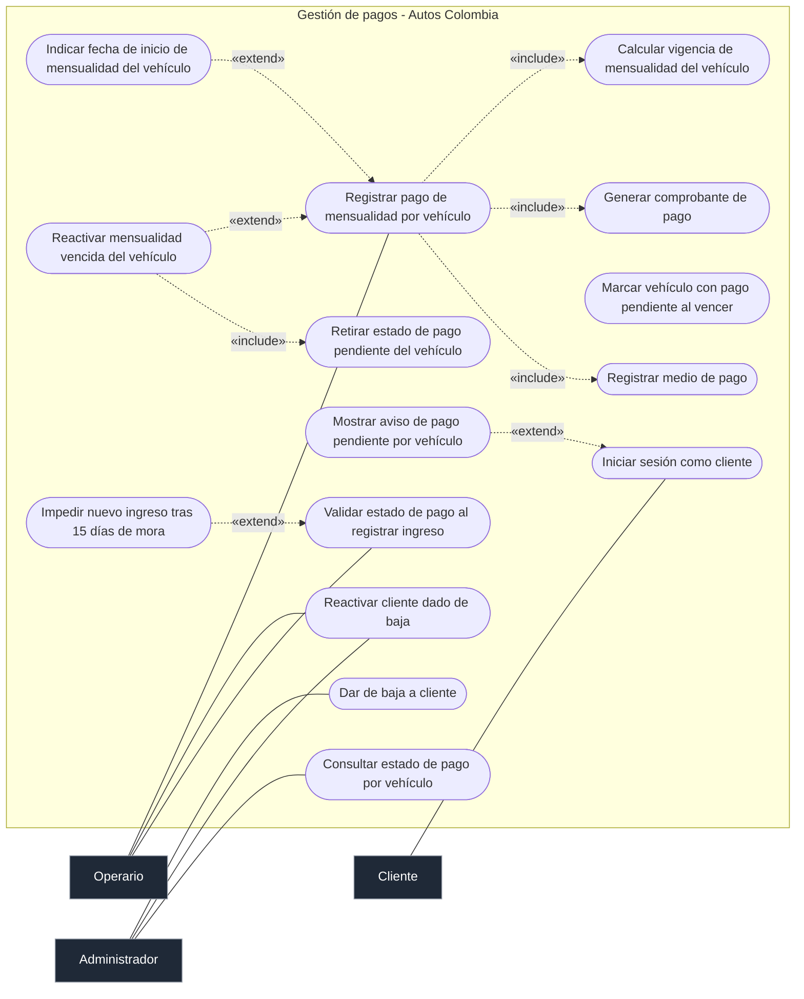
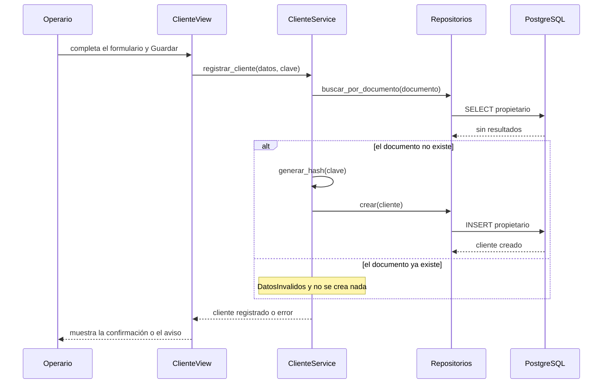
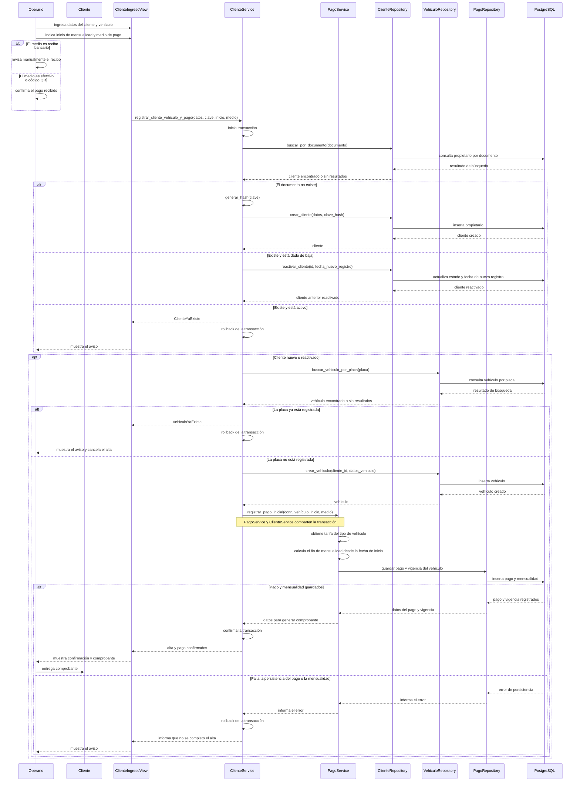

# Diseño Sistema de Información – Iteración 3

## Gestión de pagos del parqueadero "Autos Colombia"

---

## Introducción

Esta iteración aborda la gestión de pagos que sostiene el servicio mensual del parqueadero. El cobro se organiza por vehículo: el operario registra el medio de pago y la fecha elegida para iniciar la mensualidad, que puede ser distinta del día en que se paga. Esa diferencia afecta la vigencia, el acceso y la información del comprobante, por lo que el diseño la mantiene explícita. El documento reúne los requerimientos, historias de usuario, casos de uso, mockups y diagramas que conectan el flujo con el resto del sistema. También separa las reglas indicadas por el profesor de decisiones adoptadas para resolver aspectos que quedaron abiertos, como el periodo de gracia y el aviso previo al vencimiento.

## 1. Requerimientos funcionales y no funcionales

Los requerimientos de esta iteración salen del texto que dejó el profesor sobre la gestión de pagos. Separé las reglas funcionales de las cualidades del sistema y dejé aparte las decisiones que el profesor no definió. Se conserva la regla previa: la mensualidad se cobra por vehículo. Cada vehículo tendrá su propia vigencia, pago y estado; el portal podrá seguir mostrando al cliente el total de sus vehículos habilitados.

Para organizar esos datos, el pago y la mensualidad se asocian al vehículo, mientras que los vehículos siguen perteneciendo a un cliente. Si un cliente tiene varios vehículos, se registra el pago correspondiente a cada uno. La consulta administrativa muestra el estado por vehículo, pero el administrador no registra pagos. Las decisiones sobre vencimientos, acceso y comprobantes que no aparecen en el texto del profesor están identificadas como supuestos.

### 1.1 Requerimientos funcionales

| ID | Requerimiento |
|---|---|
| RF-PAG-01 | El sistema debe exigir el pago por adelantado al registrar o contratar el servicio para cada vehículo nuevo. |
| RF-PAG-02 | El sistema debe permitir al operario registrar la fecha en que el cliente indica que comienza la mensualidad de cada vehículo, que no necesariamente coincide con la fecha del pago. |
| RF-PAG-03 | El sistema debe calcular automáticamente la fecha de cierre de la mensualidad sin preguntarla (si inicia el día 5, termina el día 4 del mes siguiente). |
| RF-PAG-04 | El sistema debe permitir que el operario registre el pago correspondiente a la mensualidad de un vehículo. |
| RF-PAG-05 | El sistema debe admitir como medios de pago el efectivo, el código QR y el recibo bancario que el cliente presenta al operario. |
| RF-PAG-06 | El sistema debe entregar al cliente un comprobante con la fecha del pago, la vigencia del pago, la fecha de la mensualidad (inicio y fin), el usuario y el valor pagado. |
| RF-PAG-07 | El sistema debe habilitar el servicio del vehículo a partir de la fecha de inicio de su mensualidad, no de la fecha en que se hizo el pago. |
| RF-PAG-08 | Si el cliente paga antes de que venza la mensualidad de un vehículo, el sistema debe iniciar la nueva mensualidad cuando termine la vigente, de modo que no pierda días. |
| RF-PAG-09 | Cuando termine la mensualidad de un vehículo sin que se haya pagado la siguiente, el sistema debe marcar ese vehículo con el estado "pago pendiente". |
| RF-PAG-10 | El sistema debe mostrar al cliente que tenga uno o más vehículos con pago pendiente un aviso visible (texto con fondo rojo) cada vez que acceda al sistema. |
| RF-PAG-11 | El sistema debe aceptar el pago atrasado de la mensualidad de un vehículo y reactivar su servicio desde la fecha original, sin contar como tiempo pagado los días de mora. |
| RF-PAG-12 | El sistema debe retirar el estado "pago pendiente" del vehículo cuando se registre el pago de su mensualidad. |
| RF-PAG-13 | El sistema debe permitir dar de baja a un cliente cuando este lo solicite, dejando desactivados su usuario y sus datos. |
| RF-PAG-14 | Cuando un cliente dado de baja se registre de nuevo, el sistema debe reactivar su usuario anterior en lugar de crear uno nuevo, y actualizar únicamente la fecha de su nuevo registro. |

### 1.2 Requerimientos no funcionales

El texto del profesor toca pocas cualidades no funcionales. Las que ya regían desde las iteraciones anteriores (claves con hash, trazabilidad de correcciones, concurrencia segura) no cambian, y aquí solo van las que traen los pagos.

| ID | Requerimiento |
|---|---|
| RNF-PAG-01 | **Gestión de fechas:** el cálculo de vigencias debe apoyarse en una librería de manejo de fechas, para resolver correctamente fines de mes y años bisiestos. |
| RNF-PAG-02 | **Usabilidad:** el aviso de pago pendiente debe distinguirse a simple vista del resto de la interfaz (texto sobre fondo rojo). |
| RNF-PAG-03 | **Conservación de datos:** la baja debe ser lógica; no se eliminan datos ni historial del cliente, para poder reactivarlo después. |
| RNF-PAG-04 | **Control de acceso:** solo el operario puede registrar pagos; el cliente únicamente consulta información. |

La compatibilidad de los datos de ejemplo con la nueva lógica es una consideración técnica del proyecto, no un requisito no funcional indicado por el profesor. Se deja como supuesto de implementación en la sección siguiente.

### Supuestos adoptados para completar el diseño

Estos puntos no se presentan como requisitos entregados por el profesor:

| ID | Supuesto |
|---|---|
| SUP-PAG-01 | Cada vehículo tiene su propia mensualidad, fecha de vencimiento, pago y estado. El valor total que ve el cliente sigue siendo la suma de las tarifas de sus vehículos habilitados. |
| SUP-PAG-02 | En los ciclos ordinarios se conserva el día ancla para inicios los días 29, 30 o 31. Si un mes no tiene ese día, se usa su último día válido; el periodo termina el día anterior al siguiente inicio calculado. Por ejemplo, si empieza el 31 de enero, el siguiente inicio es el 28 o 29 de febrero y ese primer periodo termina el 27 o 28 de febrero. El día ancla original se conserva para los periodos siguientes. Si el servicio se reactiva desde el día 15 de mora, la fecha del pago inicia el nuevo ciclo y pasa a ser el ancla (**decisión validada para el código**). |
| SUP-PAG-03 | El estado de pago pendiente se controla por vehículo. Se aplica al terminar su periodo sin un pago nuevo y el aviso al cliente identifica qué vehículo o vehículos están pendientes. |
| SUP-PAG-04 | El vehículo tiene 15 días calendario de gracia desde el vencimiento; el día siguiente cuenta como día 1. Desde el día 15 se bloquean nuevos ingresos, pero no se expulsa un vehículo que ya está dentro. Para reanudar después del bloqueo, si el cliente continúa, se paga el prorrateo de los primeros 15 días de gracia y una mensualidad completa por adelantado desde la fecha del pago. Si el periodo vence el 4 de abril y se paga el 20, el prorrateo cubre del 5 al 19 de abril y la mensualidad completa del 20 de abril al 19 de mayo; el día 20 pasa a ser el nuevo ancla. El prorrateo se calcula con la tarifa mensual dividida por los días reales del ciclo y multiplicada por los días cobrables, no con los días que el vehículo estuvo físicamente dentro. |
| SUP-PAG-05 | Para un recibo bancario, el operario revisa el documento presentado y registra manualmente el medio de pago. No se integra con el banco ni se valida automáticamente la transacción. |
| SUP-PAG-06 | El administrador puede consultar el estado de pago por vehículo desde la gestión de clientes y vehículos; solo el operario registra pagos. |
| SUP-PAG-07 | El comprobante puede incluir otros datos útiles además de los obligatorios. Se propone mostrar la placa para identificar el vehículo al que corresponde, sin sustituir los datos exigidos por RF-PAG-06. |
| SUP-PAG-08 | Los datos de ejemplo existentes deberán prepararse para que puedan probarse con los estados y pagos por vehículo. |
| SUP-PAG-09 | Siete días antes del vencimiento, el sistema muestra al cliente la siguiente mensualidad como opción, sin cobrarla automáticamente. El cliente puede indicar que desea continuar o enviar una solicitud de baja al administrador. Si el cliente continúa, el operario registra el pago anticipado. |

---

## 2. Diagrama de casos de uso de gestión de pagos

Un solo diagrama reúne a los actores que intervienen en la gestión de pagos. Mermaid no tiene un tipo de diagrama de casos de uso, así que se representa como un diagrama de flujo: los actores quedan afuera, los casos de uso dentro del recuadro del sistema, y las relaciones `include` y `extend` se dibujan con flechas punteadas. Las de `include` apuntan al caso incluido y las de `extend` apuntan al caso base. El sistema no aparece como actor: marcar vencimientos es comportamiento interno. La notación es una representación visual en Mermaid, no un diagrama UML formal.

El operario registra el pago correspondiente a cada vehículo. Esa operación incluye calcular su vigencia, generar el comprobante y registrar el medio utilizado. Indicar la fecha de inicio extiende el registro cuando se contrata una mensualidad nueva; pagar una mensualidad vencida también extiende el registro y, al completarse, incluye retirar el estado pendiente.

El sistema marca internamente el vehículo cuando vence su mensualidad. El cliente ve el aviso al iniciar sesión; el administrador consulta el estado de cada vehículo, pero no registra pagos. En el ingreso, el operario valida que el vehículo esté al día; si acumula 15 días de mora, el sistema impide un nuevo ingreso hasta que se registre el pago. La baja del cliente la ejecuta el administrador, y la reactivación puede hacerla él o el operario.

---

## 3. Historias de usuario de gestión de pagos

Las historias salen de los requerimientos y usan el prefijo HU-P (P de pagos) para no cruzarse con las HU-U y HU-C de la iteración anterior. Los ejemplos de fechas parten de una mensualidad que empieza el día 5, igual que en el texto del profesor.

### HU-P1. Registrar el pago de un vehículo nuevo

Como operario, quiero registrar el pago por adelantado cuando un cliente contrata el parqueadero para un vehículo, para dejar activa la mensualidad de ese vehículo desde el día que el cliente elija.

**Criterios de aceptación.** La contratación de una mensualidad para un vehículo no se completa sin pago por adelantado. El operario anota la fecha de inicio que le dice el cliente; el sistema calcula la fecha de cierre. Si empieza el 5 de marzo, termina el 4 de abril. El servicio queda habilitado desde el inicio registrado y no desde el día del pago: quien paga el 28 de febrero para empezar el 5 de marzo no puede ingresar antes.

### HU-P2. Elegir el medio de pago

Como operario, quiero registrar si el pago de la mensualidad de un vehículo fue en efectivo, con código QR o con un recibo bancario, para dejar constancia del medio utilizado.

**Criterios de aceptación.** Las tres opciones aparecen al registrar un pago. Si el cliente presenta un recibo bancario, el operario lo revisa y confirma manualmente el registro; el sistema guarda el medio de pago, sin conectarse al banco ni validar automáticamente la transacción (**Supuesto SUP-PAG-05**).

### HU-P3. Renovar antes de que venza

Como operario, quiero registrar el pago anticipado de la mensualidad de un vehículo, para que la siguiente empiece justo cuando termina la vigente.

**Criterios de aceptación.** Si la mensualidad del vehículo termina el 4 de abril y el cliente paga el 28 de marzo, la nueva va del 5 de abril al 4 de mayo. Pagar antes no recorta ni estira nada: la mensualidad es fija y no se corre hacia la fecha de pago.

### HU-P4. Entregar el comprobante

Como cliente, quiero recibir un comprobante por el pago de cada vehículo, para saber cuánto pagué y hasta cuándo tiene servicio.

**Criterios de aceptación.** El comprobante trae la fecha del pago, la vigencia del pago, las fechas de inicio y fin de la mensualidad, el usuario y el valor pagado. La fecha del pago y las de la mensualidad pueden ser distintas, y el comprobante las muestra por separado para que no se confundan. Como supuesto, también identifica el vehículo por su placa; puede incluir otros datos útiles sin omitir los exigidos por RF-PAG-06 (**SUP-PAG-07**).

### HU-P5. Consultar vehículos con pago pendiente

Como administrador, quiero consultar el estado de pago de cada vehículo desde la gestión de clientes y vehículos, para identificar cuáles tienen la mensualidad pendiente sin revisar fechas a mano (**Supuesto SUP-PAG-06**).

**Criterios de aceptación.** El sistema marca un vehículo como "pago pendiente" cuando termina su mensualidad y no hay un pago nuevo. El administrador puede consultar ese estado por vehículo desde la gestión existente de clientes y vehículos, pero no registrar pagos desde esa vista. Los vehículos al día no aparecen como pendientes.

### HU-P6. Revisar la renovación y el aviso de pago pendiente

Como cliente, quiero recibir un aviso siete días antes del vencimiento para indicar si continuaré con cada vehículo o solicitaré la baja, y ver un aviso de mora si no pago a tiempo.

**Criterios de aceptación.** Siete días antes del vencimiento se muestra la tarifa del siguiente mes sin cobrarla automáticamente, con opciones para indicar que continuará o solicitar la baja. La solicitud de baja se remite al administrador; la respuesta del cliente no registra un pago ni desactiva la cuenta. Si vence sin pago, se muestra un aviso en fondo rojo en cada acceso, identificando los vehículos pendientes (**SUP-PAG-03 y SUP-PAG-09**).

### HU-P7. Cobrar una mensualidad atrasada

Como operario, quiero registrar el pago atrasado de la mensualidad de un vehículo y reactivar su servicio, para que pueda volver a ingresar sin trámites aparte.

**Criterios de aceptación.** Si el operario registra el pago durante los primeros 14 días de mora, el ciclo se mantiene desde su fecha original: si el periodo terminó el 4 de abril y paga el 10, la siguiente mensualidad va del 5 de abril al 4 de mayo, no del 10 de abril al 10 de mayo. Desde el día 15 de mora se bloquean nuevos ingresos. Si el cliente quiere reanudar, el operario registra el prorrateo de los primeros 15 días de gracia y la mensualidad completa desde la fecha del pago; por ejemplo, un pago el 20 de abril cubre el prorrateo del 5 al 19 de abril y la mensualidad del 20 de abril al 19 de mayo. La fecha del pago pasa a ser el nuevo día ancla. El prorrateo usa la tarifa mensual dividida por los días reales del ciclo y multiplicada por los días cobrables. No se cobra automáticamente la mensualidad futura ni una multa (**Supuesto SUP-PAG-04**).

### HU-P8. Dar de baja a un cliente

Como administrador, quiero dar de baja a un cliente que decide irse del parqueadero, para dejar desactivados su usuario y sus datos sin perder el historial.

**Criterios de aceptación.** La baja es lógica: no se borra nada. Se puede hacer en cualquier momento, sin esperar a que termine la mensualidad. Sigue vigente la regla que ya existe: un cliente con un vehículo dentro del parqueadero no puede darse de baja. Un cliente desactivado no puede iniciar sesión.

### HU-P9. Reactivar a un cliente dado de baja

Como operario o administrador, quiero que al registrar de nuevo a un cliente dado de baja el sistema reactive su usuario anterior, para no duplicarlo ni perder su historial.

**Criterios de aceptación.** Si el documento ya existe y está desactivado, el sistema lo reactiva en lugar de rechazarlo por duplicado. Lo único que cambia en los datos del cliente es la fecha de nuevo registro; el resto se conserva. Como vuelve a contratar el servicio, se exige el pago por adelantado de cada vehículo que vuelva a habilitar.

## 4. Realizar los mockups de las historias de gestión de pagos en Figma u otra herramienta para hacer mockups.

Este inciso ya está solucionado en el documento escrito.

## 5. Actualizar el diagrama de secuencia que incluya lo realizado en las 3 iteraciones en STARUML.

Diagrama de secuencia de registrar cliente, este es el diagrama de la iteración anterior, los pagos se cruzan aquí por todos lados, así que este es el diagrama que hay que actualizar en base a los nuevos

### Diagrama actualizado: alta contextual y pago inicial por vehículo

El diagrama anterior se conserva como referencia de la iteración 2. Este flujo amplía el registro contextual que hace el operario cuando la placa aún no está registrada: además del cliente y el vehículo, incorpora el pago adelantado de la mensualidad de ese vehículo. Si el documento corresponde a un cliente dado de baja, se reactiva su usuario anterior; si sigue activo, no se crea un duplicado.

El flujo parte de un alta contextual: el operario registra al cliente y el vehículo cuando la placa todavía no aparece en el sistema. También indica desde qué fecha comienza la mensualidad y registra el medio de pago. Si el cliente presenta un recibo bancario, el operario lo revisa manualmente; el sistema no consulta al banco. La búsqueda por documento evita duplicados: si el cliente ya está activo, el alta se detiene; si estaba dado de baja, se reactiva su usuario anterior y se conserva su información.

Después se valida la placa. Si ya existe, la operación se revierte; si está libre, se registra el vehículo y su pago por adelantado. La fecha de inicio que indicó el cliente determina el periodo mensual, aunque el pago se haga otro día. Esa diferencia debe quedar clara en el comprobante, junto con las fechas de vigencia, el usuario, el valor y la placa. Compartir la transacción permite confirmar el alta completa o deshacerla si falla el registro del pago. Así se evita dejar un vehículo asociado sin la mensualidad que exige la contratación.

**Supuestos de diseño:** el alta contextual de cliente, vehículo y pago inicial se confirma como una sola transacción; si falla el registro del pago, se revierte el alta para no dejar un vehículo contratado sin el pago exigido. La aplicación implementa estas responsabilidades en `PagoService` y `PagoRepository`. El valor se obtiene de las tarifas de ejemplo existentes (moto: $60.000; vehículo: $120.000), pendientes de validación. Al reactivar un cliente, se conserva su información previa y solo se actualiza la fecha de nuevo registro, como pide RF-PAG-14. El fin de la mensualidad se calcula desde la fecha de inicio indicada, conservando el día ancla en fechas 29–31 según SUP-PAG-02, excepto el reinicio del ancla descrito en SUP-PAG-04.

## 6. Actualizar el diagrama de componentes que incluya lo realizado en las 3 iteraciones en STARUML.

El diagrama actualizado conserva la arquitectura por capas de las iteraciones anteriores y agrega los componentes de la gestión de pagos. En presentación aparecen `PagoView`, que permite al operario registrar el pago y obtener el comprobante, y `ClienteIngresoView`, que incluye el pago inicial cuando se registra un cliente y su vehículo desde el flujo contextual. El portal del cliente muestra los estados y avisos, mientras que la vista administrativa permite consultar el estado por vehículo; ninguna de estas vistas registra pagos.

En la capa de servicios, `PagoService` calcula las vigencias, aplica las reglas de pago y mora, y prepara los datos del comprobante. `PagoRepository` persiste los pagos y sus periodos cubiertos. `SolicitudClienteService` y `SolicitudClienteRepository` conservan la gestión de decisiones de renovación y solicitudes de baja; son componentes relacionados con el flujo del cliente, pero no realizan cobros. El servicio de ingreso consulta el estado de pago antes de permitir nuevos ingresos según la regla asumida de mora.

La información se guarda en PostgreSQL, en las tablas `pago`, `pago_detalle` y `solicitud_cliente`. Los modelos representan, entre otros datos, el comprobante, sus detalles y el estado de pago por vehículo. La tarifa no se modela como un repositorio o una tabla: sus valores actuales son constantes de ejemplo centralizadas en `PagoService`, porque no se definieron tarifas oficiales. Los colores identifican cuándo se incorporó cada componente; las notas de las cajas señalan algunas ampliaciones posteriores. El HTML del diagrama está en [diagrama_componentes_it1_it2_it3.html](./diagrama_componentes_it1_it2_it3.html); se conserva el anterior como referencia.

## 7. Diligenciar formato de plan de pruebas resumido de la gestión de pagos.

## Conclusiones

El diseño conserva una decisión central del proyecto: cada vehículo tiene su propia mensualidad, pago y estado. Distinguir la fecha del pago de la fecha de inicio evita desplazar una renovación anticipada y permite explicar con claridad qué periodo cubre el comprobante. Llevar esa regla al sistema también exigió conectar el registro del operario con el portal del cliente, la consulta administrativa y la validación del ingreso. El código y los diagramas muestran ese recorrido entre capas, desde la interfaz hasta el almacenamiento.

Algunos comportamientos —los 15 días de gracia, el aviso de renovación con siete días de anticipación y el prorrateo al reactivar el servicio— completan vacíos del enunciado; conviene validarlos antes de tratarlos como reglas definitivas. El plan de pruebas recoge 13 casos, pero solo uno figura aprobado y 12 siguen pendientes. Por eso, los artefactos definen una base concreta para revisar la gestión de pagos, aunque todavía no demuestran que todos sus escenarios funcionen como se espera.

## 8. Anexar la URL del repositorio en Github para evidenciar actualización de código fuente del proyecto.

## 9. Anexar video en Youtube mostrando el funcionamiento del sistema de información.

